# TARE & TITHE — Glass Box Engineering & Architecture Dev Log

**2026 Epic AI MegaJam | Official Theme: `"DIRECTOR'S CUT"`**

* **Solo Developer (Submission Handle):** Erdem Tatar (`Homsetxi`)
* **Engine & Codebase:** Unreal Engine 5.8 (`Blank` C++ Template — 100% C++ Gameplay & Slate UI, Zero Blueprint Gameplay Logic, Zero `USkeletalMesh` / Organic Animation)
* **Target Categories:** *Best Overall: Unreal Engine*, *Solo Driver*, *Glass Box Dev Log*, *Render Royalty*, *Hyper3D Rodin (`$10k` Prize Pool)*, and *NVIDIA RTX*
* **Pre-Jam Public Preparation Repo (Rule 7h):** `Erdemtatar/MegaJam2026-Prep` (`HEAD: 4495938` / tag `v1.0-prejam-freeze` — untouched throughout the jam)
* **Sealed Baseline Submission (`main`):** `Homsetxi_TareAndTithe.zip` — **`460.65 MB`** (`v1.0-baseline-submission` @ `5dccd9c` / `v1.0-baseline-main` @ `2f3dffa`, Native TSR, `< 1 GB` itch.io limit)
* **Isolated RTX Submission (`feat/rtx-dlss`):** `Homsetxi_TareAndTithe.zip` — **`445.62 MB`** Win64 `Shipping` (`5a71320`, UE 5.8 NVIDIA DLSS 4.5 Super Resolution & DLAA via `[F10]`, automatic `TSR` fallback on non-RTX GPUs)
* **Sourced (Non-Original) Pre-Made Assets (Rule 15c/15d):** **`None`** — All code, shaders, procedural meshes, AI-generated 3D station props, and audio assets were created specifically for this jam under strict commercial-licensing and zero third-party branding (`0` external logos) rules.
* **Production Timeline:** Initial `.uproject`, C++ codebase, procedural shaders, MetaSounds graphs, and all AI-generated assets were created strictly after `November 12, 2026, 00:00 AM ET`.

> 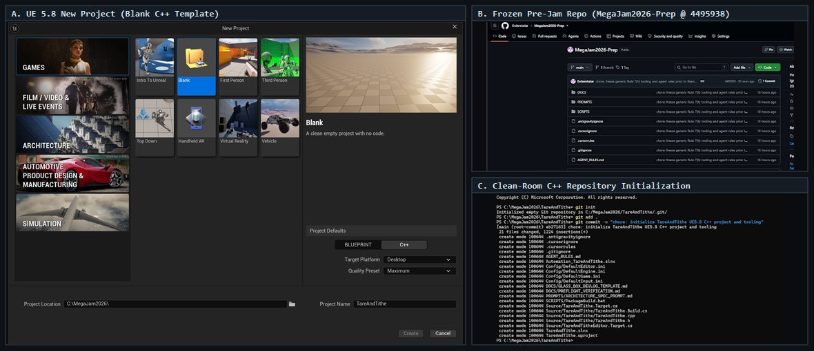
>
> *Caption: Day 1 clean-room initialization in Unreal Engine 5.8 (`Blank` C++) alongside my frozen pre-jam preparation repository (`4495938`).*

---

## 1. Theme Lock (`"Director's Cut"`), De-Biased Ideation & Concept Pruning

**30-Second Gameplay Loop:** Locked inside a subterranean foundry cell beneath the Director's Panopticon window, you inspect heavy, asymmetric slag monoliths suspended from a strain-sensitive overhead hydraulic clamp. Move the mouse to set cutting height, scroll to roll, and hold `RMB` to bevel-tilt—using real-time audio scan pulses to dodge explosive hidden isotope veins while keeping cuts balanced so off-center torque does not snap the clamp. Hold `LMB` to sever the ore with a high-energy plasma sheet, toggle `[SPACE]` to route clean yield onto the damped `TITHE` weighing pan or dump excess waste down the `TARE` scrap shaft, and press `[E]` once settled mass hits the exact quota window (`[* DIR.CUT]` center `25%` precision band awards `2x SCRIP` for `[1–3]` hardware upgrades).

### 1.1. Dual-Layer Semantic & Mechanical Theme Lock

To eliminate any ambiguity around the official theme **`"DIRECTOR'S CUT"`**, I engineered a literal, mechanical, and economic lock readable within the first 3 seconds of gameplay:

1. **Diegetic Authority & Quota Extraction:** Locked inside a brutalist subterranean inspection cell beneath a `600 cm` 3-bay Panopticon overlook (`OFFICE OF THE DIRECTOR`), the player operates as **`INDENTURE #409`**, slicing raw industrial slag monoliths to deliver the exact mandatory mass commission—the **Director's Cut (`TITHE`)**—onto a damped mechanical weighing pan while routing excess or contaminated mass down the **`TARE`** scrap shaft.
2. **High-Skill Precision Window (`[* DIR.CUT]`):** Landing total settled pan mass inside the center `25%` (`±0.21..0.34 kg`) precision band of a contract's target window triggers the **`[* DIR.CUT]`** verdict badge and awards double company scrip (`+2 SCRIP` vs. standard `+1 SCRIP`) to clear the operator's 3-shift (18-contract) indenture bond and fund hardware upgrades (`[1] HYD` `+25%` clamp torque capacity, `[2] TARE` `+5.0 kg` scrap allowance, `[3] SCAN` `+30%` isotope scan range & `+25%` faster pan damping).

### 1.2. Breaking AI Brainstorming Bias & Killing 18+ High-Risk Concepts

During Hour 1 ideation, I caught a critical prompt-bias flaw: feeding example interpretations (framing, jump-cuts, spatial slicing) into an LLM narrowed its output space to generic camera-gimmick games. I stripped all adjectives and mechanics from the prompt and fed independent models **pure engineering walls** (`6 GB` VRAM budget on an RTX 3060 Laptop, zero skeletal animations, continuous `[0.0f, 1.0f]` MetaSounds telemetry streams, and 30-second comprehension). Across independent runs, models converged on two finalists, allowing me to prune **18+ production-trap concepts** before writing a single line of C++:

* **Runtime World-Welding & Terrain Carving (`SEAMLINE`, `SCAR LINE`):** Rejected because runtime collision cooking under high-speed Chaos bodies produces Lumen GI surface-cache pops and physics tunneling by Hour 60.
* **High-Velocity Track Splicers (`SPLICE OVERDRIVE`, `SMASH CUT`, `TETHER SHEAR`):** Rejected due to unsustainable modular spline/track authoring overhead for a solo C++ developer and weak pun-based theme ties (*"cutting a corner"*).
* **Combinatorial Stem Mixing (`DEAD STEM`) & Autonomous Escorts (`HARD CUT STUNTS`, `UNCUT RUN`):** Rejected to avoid `2^4 = 16` musical stem mixing suicide and player-induced debris softlocks.
* **Finalist Elimination (`MATTE OVERRIDE` vs. `TARE & TITHE`):** `MATTE OVERRIDE` (cinemascope crop bars turning obstacles into wireframe) suffered from a full-box clipping paradox and two days of level layout. **`TARE & TITHE`** won because a single enclosed cell focuses `100%` of GPU, physics, audio telemetry, and 3D asset fidelity `1 meter` in front of the player.
* **ESRB Teen 13+ Compliance Audit (Rule 8):** Early notes described the targets as *"contraband monoliths"*. Recognizing a potential conflict with Rule 8 prohibitions on illicit substances, I re-engineered the entire lore universe into *"unlicensed deep-subterranean bismuth-tungsten industrial slag monoliths containing unstable synthetic isotope veins"*.

### 1.3. Playtest UX & Pacing Discipline (Design Over Arcade Tropes)

* **Rejecting Artificial Countdown Timers:** A ticking arcade clock directly contradicts damped spring weighing (`[SETTLING]`) and `2.21 cm` isotope clearances—rushing precision physics turns skill into RNG frustration. Tension comes strictly from cumulative clamp shear fatigue and tightening 3-shift mass tolerances.
* **Predictive Reticle Telemetry Over Modal Popups (`Ghost Vein Guard`):** Blocking tutorial popups break `FInputModeGameOnly` mouse lock and get reflexively skipped by judges. After playtesting exposed double-vein detonations on Contract 06, I added pre-slice `VEIN IN DROP! [SPACE] -> TARE` reticle warnings, non-blocking Shift 01 action-gated hints, and a **Ghost Vein Guard** that purges severed falling-half-space veins so discarded `TARE` chunks never trigger phantom scanner warnings on subsequent cuts.
* **Resisting Day-3 Developer Mastery Bias:** After 60+ hours of muscle memory, Contracts 01–03 felt "too easy." I explicitly rejected late-hour difficulty inflation to protect a first-time judge's 5-minute onboarding curve, isolating high-skill mastery inside the optional center-`25%` `[* DIR.CUT]` (`+2 SCRIP`) precision band.

---

## 2. Clean-Room UE 5.8 C++ Architecture (*Best Overall UE* & *Solo Driver*)

Every gameplay, physics, audio-bridge, lighting, and UI system in `TARE & TITHE` is built in modular C++ governed by a strict repository constitution (`DOCS/AGENT_RULES.md`):

### 2.1. Strict SOLID / ISP & Zero Concrete `Cast<>`

Concrete `Cast<AConcreteActor>()` calls across independent gameplay modules and runtime `GetAllActorsOfClass` loops are strictly forbidden. Inter-system communication flows exclusively through **four narrow C++ interfaces**—`ISliceableTargetInterface`, `IMassPayloadInterface`, `IQuotaReceiverInterface`, and `ITelemetryPublisherInterface`—paired with value-typed native C++ multicast delegates (`FContractRuntimeSnapshot`, `FSlicePreviewTelemetry`). Because Unreal Header Tool rejects returning C++ multicast delegates inside `UFUNCTION` signatures, `ITelemetryPublisherInterface` uses `CannotImplementInterfaceInBlueprint` with pure virtual C++ delegate accessors.

### 2.2. Three-Tier Zero-Idle (`0.00 ms`) Execution Model & `11 KB` Binary-Locked Map

* **Tier 1 (`bCanEverTick = false`):** `UMonolithSliceComponent`, `UVeinScannerComponent`, `UInspectionShiftSubsystem`, `UInspectorHudBridgeComponent`, `ATareTitheGameMode`, `AInspectorPawn`, `AMonolithRigActor`, and `AScaleAssemblyActor` run strictly on discrete events, native delegates, or bounded timers.
* **Tier 2 (`bCanEverTick = true`, `bStartWithTickEnabled = false`):** `ULaserPlaneAimComponent`, `UClampTorqueSolverComponent`, `UScaleWeighingComponent`, `ADirectorBoothActor`, and `UMoltenThermalLightComponent` wake up solely during active motion/damping and immediately self-disable on convergence (`0.00 ms` idle CPU cost).
* **Tier 3:** Chaos physics sub-stepping.
* **`11,524-Byte` Empty `.umap` Shell (`0 Byte Diff`):** `Content/Maps/L_MainGameplay.umap` is an empty `11 KB` shell locked against binary edits. The entire inspection cell, Panopticon deck, lighting rig, camera exposure lock, and station actors spawn deterministically in C++ via `UTareTithePresentationDataAsset` (`/Game/Presentation/DA_Presentation`), shielded for Win64 packaging by excluding `UnrealEd`/`GeometryScriptingEditor` in `Build.cs`, wrapping validation in `#if WITH_EDITOR`, and locking `+DirectoriesToAlwaysCook`.

### 2.3. Real-Time 3D `DynamicMesh` Slicing, 13-Axis SAT & Zero-Allocation Mass Preview

1. **Baked `UV0` Box Projection:** Static box-projected `UV0` coordinates are baked once at monolith spawn so tilting clamp jaws and CoM-recentered chunks exhibit zero `WorldAligned` texture swimming.
2. **Deterministic Molten Cap ID (`FMeshPlaneCut`):** Because UE 5.8's Blueprint plane-cut wrapper lacked cut-face material ID assignment, `UMonolithSliceComponent` invokes C++ `UE::Geometry::FMeshPlaneCut` and `ConstrainedDelaunayTriangulate<double>` directly, stamping `MaterialID = 1` (incandescent molten slag) onto `Cut.HoleFillTriangles`.
3. **Concave Island Split & 13-Axis 3D SAT:** Multi-island concave cuts are separated via `FMeshConnectedComponents`. Both upper clamp retention and hidden spherical isotope vein clearance use **13-axis Akenine-Möller 3D Triangle-Box Separating Axis Theorem (SAT)** queries over `FDynamicMeshAABBTree3` plus `TFastWindingTree` containment checks.
4. **Sliver Vaporization & Object Pooling:** Degenerate slivers (`< 25 cm³` or `< 0.6 cm` thickness) that trigger coplanar Chaos convex hull `NaN` velocity spikes are vaporized before physics creation and added analytically (`M = V * rho * 10^-3`) to `TareWasteKg`, while valid chunks spawn through a 16-actor pre-warmed `UChunkPoolSubsystem`.
5. **`0`-Heap-Allocation Divergence Theorem Mass Preview (`~0.008 ms`):** By shifting mesh vertices relative to the active laser plane origin (`v' = v - p0`), the signed tetrahedral volume contribution of the uncapped planar cross-section becomes mathematically `0.0`—enabling live `EstimateSeveredMassKg` readouts in `~0.008 ms` without cloning meshes or triangulating caps.

### 2.4. Pure C++ Slate HUD (`STareTitheHudOverlay`)

Early builds used 17 world-space `UTextRenderComponent` readouts, which suffered from pre-tonemap TSR ghosting, perspective skew, and bright Panopticon window overlap. Without creating fragile Widget Blueprint `.uasset` files under `bCookMapsOnly=True`, I built a pure C++ `HitTestInvisible` Slate HUD (`STareTitheHudOverlay`) featuring `125%–150%` DPI overflow guards, a camera-shake-isolated `[0..1]` UV reticle card, discrete `MakeBox` CRT console scanlines, a Schmitt-trigger `P0..P3` center alert banner (`EActiveTimerReturnType::Stop` at rest), and 7-bit ASCII colorblind-safe status badges (`[EMPTY]`, `[SETTLING]`, `[UNDER]`, `[VALID]`, `[* DIR.CUT]`, `[OVER]`, `[FAULT]`).

> 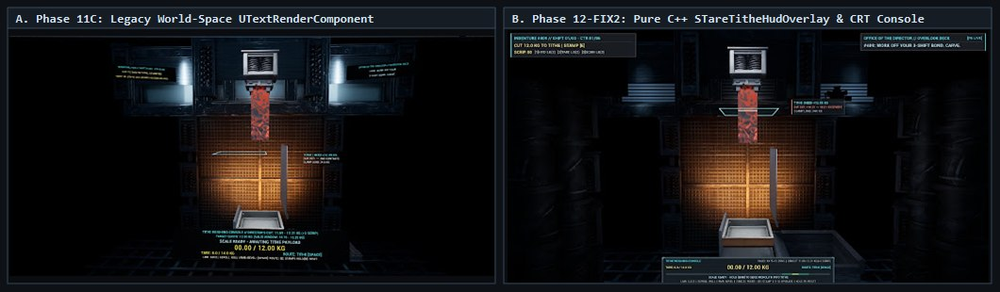
>
> *Caption: UI evolution from world-space `UTextRenderComponent` readouts (left, suffering from perspective skew and window glare) to my zero-`.uasset` pure C++ `STareTitheHudOverlay` Slate HUD and CRT weighing console (right).*

---

## 3. 3D Asset Pipeline, Procedural Shaders & Visual Polish (*Hyper3D Rodin* & *Render Royalty*)

### 3.1. Hyper3D Rodin Gen-2.5 Pipeline & Zero-DCC Headless Solidification

To fit my `6 GB` VRAM target and preserve exact alignment with invisible physics colliders (`PanDeckCollider`, `DiverterPlateCollider`), I enforced strict envelope rules across **11 custom Hyper3D Rodin Gen-2.5 `.glb` assets** (`SM_ScaleBase`, `SM_ScalePan`, `SM_DiverterFlapper`, `SM_ClampJaw`, `SM_DirectorBoothFrame`, `SM_ClampSpringHousing`, `SM_TareChute`, `SM_DirectorShutter`, `SM_CellFloorGrate`, `SM_Monolith_Contract04`, and `SM_Monolith_Contract06`): `Agentic Mode` disabled, `Clean` profile, `Triangle` topology (`~8k–15k tris`), `Symmetric = ON` for station hardware, and embedded `2048x2048` PBR `.glb` export (`Shaded` unchecked).

* **Overcoming `Turbo Gen` Hallucinations via Hybrid `Image to 3D`:** While the first 3 station props succeeded in `Turbo Gen` via trigger-word pruning (`pancake-flat floor slab only`), complex mechanical parts repeatedly ignored negative prompts (`SM_ClampJaw` produced 5 consecutive bench-vise pedestals and flat pliers; `SM_DirectorBoothFrame` generated a 6-pane white residential window). For assets 4 through 11, I generated envelope-exact isometric reference renders externally and fed them directly into Rodin's `Image to 3D` pipeline. Because Rodin's multi-image input reconstructs multi-view angles of a single subject rather than batch-queueing distinct props (fusing separate sheets into one hybrid mesh), assets 4–11 were dispatched strictly as `x1` serial jobs through Rodin's `Mine` background queue.

> 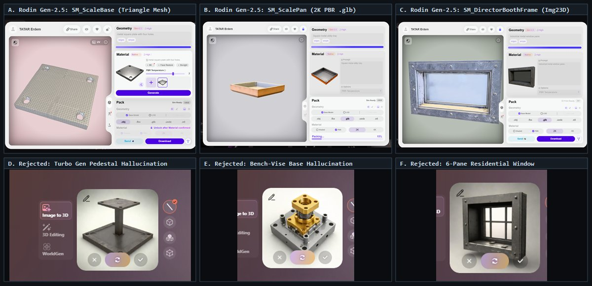
>
> *Caption: Hyper3D Rodin Gen-2.5 production workflow—pivoting from `Turbo Gen` pedestal hallucinations to envelope-locked `Image to 3D` industrial station assets and sliceable monoliths (`Clean` triangle mesh, `2K` PBR `.glb`).*

* **Zero Manual Blender/DCC Cleanup — Headless `GeometryScript` Calibration (`394449f`):**
  * Raw `.glb` files from Rodin were batch-imported headlessly via `UnrealEditor-Cmd.exe` and `SCRIPTS/ImportRodinBatch.py` with **zero manual DCC/Blender intervention**, applying automatic `90°` Z-yaw aspect-ratio protection to wide station assets.
  * Both sliceable hero monoliths (`SM_Monolith_Contract04.glb` and `SM_Monolith_Contract06.glb`) were passed through UE 5.8 `GeometryScript` **`ApplyMeshSolidify`**, converting them into single-island, **`IsClosed = True` (`100%` watertight manifold)** solids optimized to **`2,500` triangles** with **`bAllowCPUAccess = True`**.
  * Because voxel solidification strips original UV islands, the script automatically baked **Box-Projected `UV0`** coordinates onto the watertight meshes, calibrated analytical densities from exact `VolumeCm3` integrals, and verified hidden vein surface clearances via BVH signed distance:
    * **`SM_Monolith_Contract04`:** `(39.5, 41.8, 82.0) cm`, volume `113,367.9 cm³`, calibrated density `0.5868 g/cm³` → **`66.53 kg`** (`8.17 cm` minimum vein clearance).
    * **`SM_Monolith_Contract06`:** `90°` Z-yaw, `(42.2, 46.0, 85.9) cm`, volume `94,347.0 cm³`, calibrated density `0.8857 g/cm³` → **`83.56 kg`** (`2.21 cm` minimum vein clearance).
  * Contracts 02, 03, and 05 pair these hero assets with watertight Z-monotonic C++ `GeometryScript` profiles (`CantileveredJHook`, `OffsetCChannel`, `CounterweightedZBracket`) and eccentric grip offsets so asymmetric torque challenges start immediately. Total `Content/` footprint remained just **`75.37 MB`**.

> 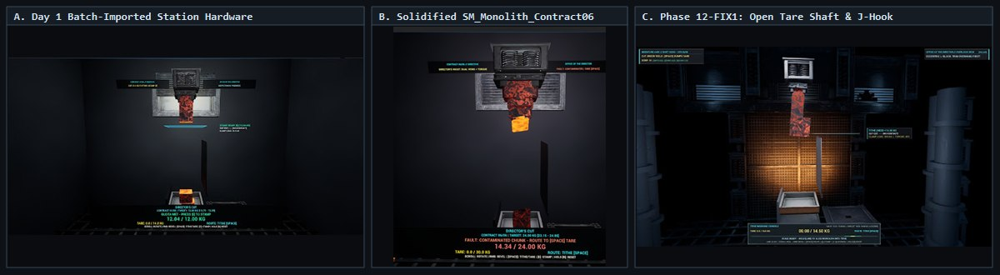
>
> *Caption: Headless `ImportRodinBatch.py` manifold solidification and in-engine integration of all 11 Rodin assets alongside Z-monotonic asymmetric `GeometryScript` profiles.*

### 3.2. Bypassing `PBRgen` for Procedural UE 5.8 Shaders & 3D OBB Laser Masking

* **Deliberate `PBRgen` Rejection:** Although `PBRgen` was evaluated during pre-jam planning, I deliberately bypassed external tileable AI texture generation (`0` external `PBRgen` textures in the final build) to protect the `6 GB` VRAM ceiling, maintain a Git-LFS-free repository, and avoid `ADecalActor` / world-space swimming on dynamic actors. All `27` 2K PBR textures come directly from the 9 Rodin station `.glb` embeds, while `M_CellWall_Master`, `M_CellFloor_Master`, `M_SlagOuter_Master` (`UV0` domain-warped crimson-oxide ore strata), `M_MoltenCutCap_Master`, and `M_StationPBR_Master` (3-layer object-locked soot and roughness breakup, `PS 558 / VS 153`) were generated programmatically via `SCRIPTS/BuildMaterialsAndBind.py` (`UMaterialEditingLibrary`).
* **Bevel-Rotating 3D OBB Laser Contact Line (`M_LaserSheet_Master`):** Standard `DepthFade` vanished to `< 0.6 px` at shallow grazing camera angles and falsely lit the steel `[SPACE]` diverter flapper and upper clamp jaws whenever the laser plane intersected them simultaneously. I exposed `ISliceableTargetInterface::GetCuttableWorldMask()`—a bevel-rotating 3D Oriented Bounding Box (OBB) evaluated against analytical `P_scene` in the shader—producing a blazing `#FFF6D6` (`peak_R = 251 sRGB`) incandescent contact core on the monolith with **`0 pixels` of false glow** on adjacent machinery, driven by a unified 6-state color machine (`Cyan`, `Emerald`, `Yellow`, `Amber`, `Red`, and `OvershootMagenta`).
* **Zero-CPU GPU Thermal Cooling & Panopticon Framing:** Freshly severed `MaterialID = 1` faces (`M_MoltenCutCap_Master`, `PS 454 / VS 148`) cool over a `3.85s` GPU `Time` curve (`0.00 ms` CPU) synced with Tier-2 `UMoltenThermalLightComponent` ember bounce lights. Above the cell (`1` VSM `KeySpot` + `10` shadowless lights, `VolumetricFog = False`, `BloomThreshold = 1.65`), I suppressed Panopticon window glare by `48.8%`, installed `17` louver slats, framed a crisp `F0 ~ 0.003` humanoid Director silhouette with Nyquist-safe twin surveillance optic glints, and darkened the rear foundry grate by `-27.8%` behind heavy cast-iron pipes.

> 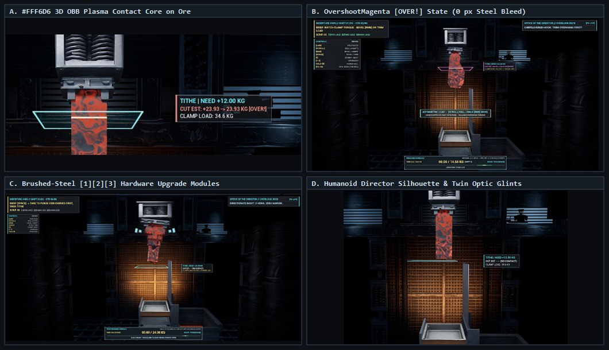
>
> *Caption: Bevel-rotating 3D OBB plasma contact mask (`#FFF6D6` core on ore, `0 px` bleed on adjacent steel), `OvershootMagenta` quota warning state, brushed-steel upgrade modules, and the Panopticon Director overlook.*

---

## 4. Commercial-Safe AI Foley, Procedural PA Synthesis & MetaSounds

* **License Hygiene (`< $1.00` Total Spend):** During Day 1 legal auditing, I rejected the free `WeLoveIndies` jam pack due to its *Non-Commercial* license restriction, as well as compressed MP3 outputs (which inject silent padding clicks into seamless loops). Using `< $1.00` of my `$30.00` `fal.ai` jam credit, I generated 6 dry `48 kHz` 16-bit PCM `.wav` foley assets exclusively from **`Commercial use`** endpoints: **ElevenLabs Sound Effects v3** (`pcm_48000` for seamless loops `SFX_CellAmbience_Loop`, `SFX_ClampSteelGroan_Loop` and sub-bass mechanical impacts `SFX_ScalePanImpact_OneShot`, `SFX_PneumaticValve_OneShot`) and **Mirelo SFX 2.0** (`wav` for `SFX_PlasmaSlice_OneShot` and `SFX_MoltenSlagHiss_OneShot`, selecting the 4th waveform after rejecting 3 silent/sparse generations). When literal text prompts like `"scale pan"` yielded thin kitchenware clangs, I pivoted to classic acoustic foley substitution—prompting `"cast iron block dropped on solid steel anvil"` on single-model Playground endpoints and pitch-shifting `0.75x–0.85x` in-engine for heavy industrial mass.
* **Three-Layer Reactive Audio Architecture:**
  1. **UE 5.8 MetaSounds (`MS_TelemetryLoops`):** Continuously modulates `VeinProximity`, `ClampStrain`, `ClampFatigue`, and `LaserCharge` streams (`0.01f` deadband) alongside polyphonic 3D spatial impacts (`SA_InspectionCell`).
  2. **2D Stereo Structural Groan Envelope (`ClampGroanAudioComponent`):** To prevent critical clamp-shear audio from getting downmixed to mono or masked by room tone, `AInspectorPawn` drives a dedicated two-zone stereo hazard curve (`< 0.46` silent; `>= 0.66` high-stress groan + `0.85s` slice surge + `0.08s` snap cutoff).
  3. **Python-Synthesized PA Intercom Signatures:** Rejecting immersion-breaking TTS voices, I synthesized three `44.1 kHz` 16-bit industrial PA radio signatures (`Directive`, `Approve`, `Reprimand` with `>= 0.35s` debounce) directly in Python.

> 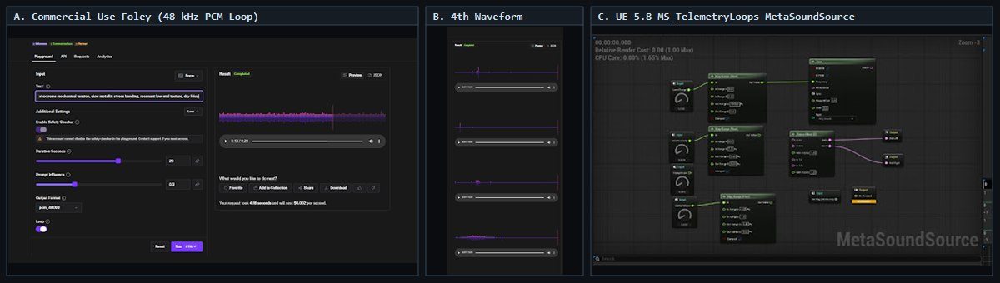
>
> *Caption: Commercial-safe `fal.ai` foley generation (waveform inspection on `SFX_MoltenSlagHiss`) paired with the 4-channel UE 5.8 `MS_TelemetryLoops` MetaSounds graph.*

---

## 5. Crisis Autopsies & Human-in-the-Loop Engineering (*Glass Box* Core)

True *Glass Box* development is defined not by letting AI write unchecked code, but by how human architectural gates diagnose engine-level failures and halt bad AI proposals.

### 5.1. Seven Major Engineering Crises & Root-Cause Resolutions

1. **Live Coding UHT Reflection Offset Corruption (`CLAMP LOAD: 0.0 KG` — Phase 9.5):** Inserting new fields into the middle of `FContractRuntimeSnapshot` (`USTRUCT`) during an open-Editor Live Coding patch left UHT's reflection table stale, causing `CopyScriptStruct` to read `+20` bytes off into `InFlightMassKg == 0.0f`. I replaced reflection-marshalled dynamic delegates with native C++ `DECLARE_MULTICAST_DELEGATE_OneParam` channels and mandated Editor-closed cold UBT builds for all header changes.
2. **"Bluetooth Slicing", `+X` Depth Shift & Left-Handed Winding Sign (Phase 9.5b):** Live playtesting exposed three geometric bugs: asymmetric L-blocks shifted `+X` behind the clamp jaws (`ComputeTopGripCrossSectionBounds` fix), UE5's left-handed winding caused `A.Dot(B.Cross(C))` volume previews to clamp to `+0.00 KG`, and infinite-plane math allowed slicing monoliths from empty air beside the `72x68 cm` visual sheet—solved via a **Finite Sheet Aperture Gate**.

> 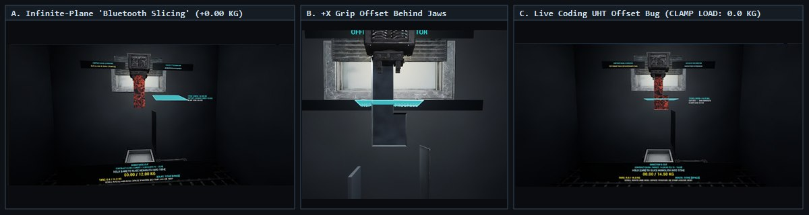
>
> *Caption: Phase 9.5b playtest diagnostics catching infinite-plane "Bluetooth Slicing", `+X` grip offset, and Live Coding UHT struct marshalling corruption.*

3. **The Pitch-Black `Lit` Viewport Mystery (`HWRT TLAS` + `ASpotLight -90°` CDO — Phase 11A-Fix):** After enclosing the cell, `Lit` mode rendered pitch-black while `F4` (`Detail Lighting`) and `F5` (`Shader Complexity`) confirmed intact geometry. Root-cause audit uncovered two engine traps: (a) with `r.RayTracing=True`, the 5 enclosing boundary slabs blocked all secondary Lumen rays in the HWRT TLAS until `SetVisibleInRayTracing(false)` was set; and (b) `ASpotLight` carries a default `-90°` relative pitch offset (`SpotLight.cpp:28`), pointing all 4 actor-rotated spotlights `90°` away from the station. I fixed component world rotations and added multi-frame `SCS_FinalColorLDR` sRGB pixel-luminance gates to prevent blind automation passes.

> 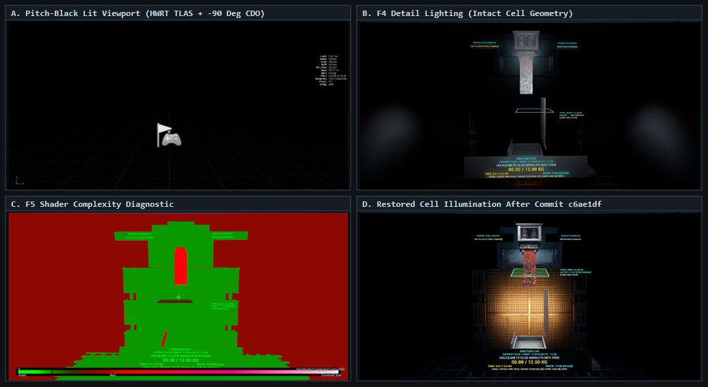
>
> *Caption: Diagnosing the Phase 11A HWRT TLAS Lumen occlusion and `ASpotLight -90°` CDO pitch trap using `Lit`, `F4`, and `F5` viewmodes before vs. after commit `c6ae1df`.*

4. **The Mass-Depletion Torque Paradox (Phase 11B):** Repeated one-sided cuts failed to snap the overhead clamp because removing mass lowered static gravity torque even as eccentricity grew. I derived exact severed-chunk CoM via initial mass-moment conservation (`c_cut`) to accumulate asymmetric shear stress and generated runtime simple convex hulls on snap so the dropped remainder falls cleanly under Chaos gravity.
5. **`~1,000 ms` Clamp-Snap Freeze → `< 1.0 ms` (`FConvexDecomposition3` — Phase 12-FIX5):** Snapping Contract 04's 2,500-triangle concave Rodin monolith froze the GameThread for `~850–1,200 ms` due to synchronous `MaxConvexHullsPerMesh = 4` `FConvexDecomposition3` cooking. Pre-caching a single 26-DOP hull via `PreCookRemainderSimpleCollision()` eliminated `FConvexDecomposition3` completely—cutting fatigue snap time to **`~0.18 ms`** and slice-induced snap time to **`< 1.0 ms`**.
6. **Mid-Air Scale Depression & `1,800 ms` `[E]` Stamp Freeze (Phase 12-FIX1 & 12E):** Chunks entering the tall `PanTriggerBox` depressed the spring pan `100+ cm` in mid-air; separating spatial containment (`ContainedPayloads`) from rigid-body `OnComponentHit` (`ImpactedScalePayloads`) fixed impact timing while preserving 3-high chunk stacking. Later, tracing a sluggish `[E]` level transition revealed `TryStampQuotaVerdict` was reusing the `1.80s` fault-penalty timer—replaced with a crisp `1.10s` shutter-nod receipt transition (`0.22s` instant `[E]` skip) and `0.18s` `1.5°` FOV punch.
7. **Packaged `.exe` `CTR 06/06` `[SETTLING]` Soft-Lock Rescue (Phase 13A):** During pre-seal standalone `.exe` testing, Contract 06 (`24.03 / 24.00 KG`) soft-locked on `[SETTLING]` when 5–6 wedged 26-DOP Rodin chunks trapped inside the pan guards experienced `2.1–4.8 cm/s` Chaos PBD micro-jitter excited every frame by `SetRelativeLocation(..., bSweep = true)`, while floor-bounced chunks landed in horizontal dead-zones. Commit `ee6bd5f` halted `bSweep` upon spring convergence, introduced a dual-path settling gate (`0.15s` quiet path + `0.55s` mass-stable micro-jitter envelope with `PutAllRigidBodiesToSleep()`), expanded `AStrayFloorCatchActor` (`Z in [-100, -50] cm`) so floor-bounced chunks stay physically visible on the `-85 cm` grate without blocking `[E]`, and passed a **`ChunkCount=55`** stress test with `0` warnings/errors.

> 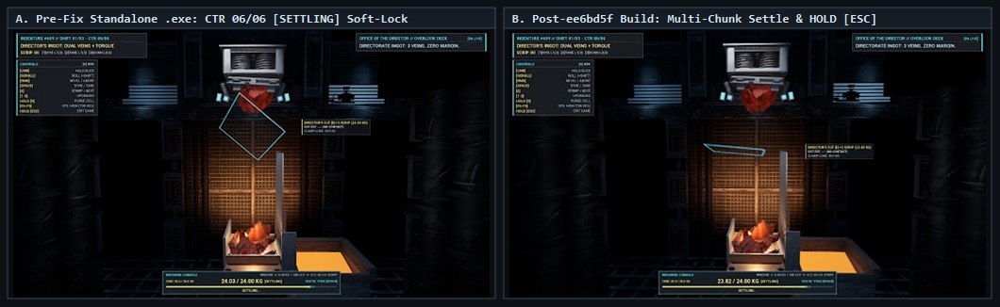
>
> *Caption: Catching and resolving the packaged `.exe` multi-body Chaos PBD `[SETTLING]` soft-lock on Contract 06 (`ee6bd5f`), verified up to `ChunkCount=55` in the sealed `v1.0-baseline-submission` build.*

### 5.2. Human Pre-Code Approval Gates: Stopping AI Blind Spots & Runaway Loops

* **Catching a Wrong Contest Theme Hallucination:** In Phase 13A planning, my local coding agent hallucinated the jam theme as *"That's Not How It Works"* from stale template residue; my Pre-Code Gate intercepted the error immediately and locked all documentation to **`"Director's Cut"`**.
* **Halting Runaway Automation Loops (`Zero-Retry-Loop Discipline`):** After a clean `11.70s` cold UBT compile in Phase 12-FIX5, the agent burned ~20 minutes launching and killing `UnrealEditor.exe` five times inside a synthetic Python test script (`VerifyPhase12Fix5Live.py`) trying to guess a single-slice clamp-snap angle (echoing an earlier `5m0s` stream timeout). I manually aborted the agent, deleted throwaway test scripts, and codified **Section 7 (`Zero-Retry-Loop Discipline`)** in `AGENT_RULES.md`.
* **Rejecting Regression-Inducing & Rule-Breaking Proposals:** Across phases, human code review rejected AI proposals to modify frozen `MonolithSliceComponent.cpp` for a `~4 ms` micro-gain (risking UV/MaterialID regressions), skip `EShiftPhase::ContractIntro` (which would break `Hold [R]` resets), call `FPlatformMisc::RequestExit(false)` (which kills the Editor), ship without an `ESC` handler (`HOLD [ESC]` `0.35s` `UKismetSystemLibrary::QuitGame` was built instead), or record a `75–85s` showcase video that would violate Rule 1(e)'s strict **`30–60 second`** limit.
* **Defeating Context Rot:** When multi-phase chats caused browser DOM export failures and dropped PowerShell Git gates after 13+ high-res screenshots, I stopped relying on chat history—anchoring every phase to deterministic `DOCS/*.md` contracts, fresh session handoffs, and atomic Git commits.

---

## 6. Hardware Telemetry & Performance Proof

Tested on my target baseline hardware (**Intel Core i7-11800H, NVIDIA RTX 3060 Laptop GPU, 6 GB VRAM**):

* **QHD Stress Test (`2176x1163` Internal @ `85%` TSR, with Unreal Editor open in background):** `GPU Time = 12.80 ms` (`<= 13.0 ms` target ceiling), `Game = 10.52 ms`, `Draw = 0.00 ms`, `RHIT = 0.17 ms`, `VRAM = 3.65 / 4.60 GB`, `Draws = 355`, `Prims = 51.5K`. Because this Editor-attached session ran under a `60 Hz` VSync frame cap (`Frame = 16.67 ms`, leaving `~3.87 ms` of idle GPU headroom), `stat unit` reports `Input = 35.95 ms`—reflecting `~2` buffered `16.67 ms` VSync swapchain frames of end-to-end input-to-present pipeline latency rather than CPU input-polling cost.
* **Uncapped 1080p Gameplay & `F5` Shader Complexity Trade-Off:** Standalone uncapped 1080p gameplay runs at `~7.50–9.15 ms` median frame time (`~109–128 FPS`) with runtime `[F6–F9]` TSR scaling (`65%`–`100%`). On UE 5.8's `F5` Shader Complexity view (`MaxShaderComplexityCount = 2000`), all 9 Rodin PBR station meshes and structural ISM columns/pipes (`~70%` of screen pixels, `M_StationPBR_Master` at `PS 558`) remain bright green (`Good`). The recessed lateral boundary slabs (`M_CellWall_Master`, `5` computational 3D `NOISEFUNCTION_GRADIENT_ALU` octaves) and sliceable slag monoliths (`M_SlagOuter_Master`, `14` 3D `NOISEFUNCTION_GRADIENT_ALU` Perlin octaves across `5` domain-warped ridge nodes, plus single-layer translucent `M_LaserSheet_Master` on the `72x68 cm` cutting plane) read maroon/red by deliberate design (`0` pink/white `Extremely Bad` pixels): trading external `PBRgen` texture maps for pure procedural ALU math saved hundreds of megabytes of VRAM (`3.65 GB` total), while opaque Early-Z (`0` opaque overdraw) and the monolith's `< 4%` screen-area footprint kept QHD GPU time locked at `12.80 ms`.

> 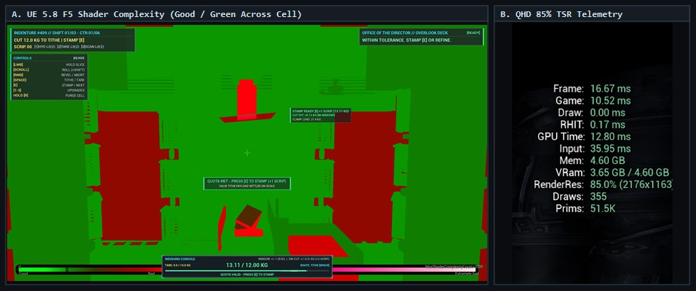
>
> *Caption: Hardware verification on an RTX 3060 Laptop (6 GB VRAM)—`F5` Shader Complexity showing bright-green Rodin PBR station hardware (`PS 558`) alongside deliberate ALU-over-VRAM procedural noise on the `< 4%` screen-area monolith (`0` pink/white pixels), paired with `12.80 ms` GPU time at `60 Hz` VSync-capped QHD (`2176x1163`, `355` draw calls, `3.65 GB` VRAM).*

---

## 7. Phase 14 (Final 30h): Isolated UE 5.8 DLSS 4.5 Neural Reconstruction (`feat/rtx-dlss`)

With ~30 hours remaining before submission, I froze sliceable geometry at 6 verified monolith profiles (rejecting late-hour mesh scope creep) and executed `AGENT_RULES.md` §6.2 (**`Baseline-Zip-First` Gate**): zero third-party upscaler dependencies touched the project until the verified **`460.65 MB`** Native TSR archive was vaulted and tagged on `main` (`2f3dffa`). Only then did I branch into **`feat/rtx-dlss` (`5a71320`)**:

1. **Scope Discipline & Engine-Level Binary Isolation (`DLSS-SR` + `DLAA` Only, Zero Frame Generation):**
   * I rejected copying third-party `.dll` binaries into `TareAndTithe/Plugins/` (which would pollute Git history), installing strictly **`DLSS`** and **`StreamlineNGXCommon`** (`UE 5.8 NVIDIA DLSS 4.5 v8.9.0`, NGX `310.9.16`) under `Engine/Plugins/Marketplace` with conditional `WITH_TARETITHE_DLSS=1` detection in `TareAndTithe.Build.cs` (`0` `.umap`/`.uasset`/`.dll` diffs in Git; `46.45s` cold UBT compile with `0` errors / `0` warnings; **`445.62 MB`** Win64 `Shipping` archive bundling `nvngx_dlss.dll`).
   * I deliberately excluded `StreamlineDLSSG` (Frame Generation) and `DLSS-RR`: optical-flow swapchain hooks restrict support to DX12 RTX 40/50 GPUs, carry UE 5.8 frame-skip/resize issues (`6706974`, `6699882`), bloat archives by hundreds of megabytes, and induce post-tonemap ghosting across my pure-C++ `STareTitheHudOverlay` reticle—whereas Transformer-based DLSS Super Resolution + DLAA preserves razor-sharp UI readability across all RTX generations.
2. **Tier-1 Zero-Tick `UUpscalerSettingsSubsystem` & `[F10]` Vendor-Neutral Judge Bridge:**
   * Rejecting `AInspectorPawn` bloat, all reconstruction state lives inside `UUpscalerSettingsSubsystem` (`UGameInstanceSubsystem`, `0.00 ms` idle CPU cost, zero ticking) behind a narrow zero-`Cast<>` `IUpscalerControlInterface` contract, isolating `#include "DLSSLibrary.h"` to a single `.cpp` translation unit.
   * Both `SuperRes_*` (defaulting to `SuperRes_Auto` with `PIE`/`(0,0)` startup fallback to `SuperRes_Quality`) and `SuperRes_NativeAA` (`100.0f` DLAA) run exclusively via non-deprecated `UDLSSLibrary::EnableDLSS(true)` and `UDLSSLibrary::GetDLSSModeInformation` (avoiding deprecated `SetDLSSMode`/`EnableDLAA` and removed `r.NGX.DLSS.Sharpness`/`DilateMotionVectors` CVars).
   * **Judge `[F10]` Bridge (Rule 15d Trademark Hygiene):** Because in-game UI strips all third-party brand strings (`0` vendor logos or false *"Frame Multiplier"* labels), pressing **`[F10]`** on `SLeftControlsCard` cycles **`SUPER RES: AUTO / QUALITY / BALANCED / PERF / ULTRA / NATIVE AA`**—directly driving **UE 5.8 NVIDIA DLSS 4.5 Super Resolution and DLAA** under the hood—before wrapping back to **`UPSCALE: TSR`**.
3. **Neutralizing Four `v8.9.0` Engine, Shader & Non-RTX Hardware Traps:**
   * **`[F6–F9]` Scalability Hook Preservation:** Because `UGameUserSettings::SetOverallScalabilityLevel(0)` (`Low`) resets `r.AntiAliasingMethod` and clobbers `r.ScreenPercentage`, the subsystem re-enforces `r.AntiAliasingMethod = 4`, `r.TemporalAA.Upscaler = 1`, and `r.NGX.DLSS.DenoiserMode = 0` after every tier change so the NGX view extension never silently detaches.
   * **Known Issue `6907033` & `6.20f` HDR Seam Ringing Guard:** Returning to `NativeTSR` explicitly calls `UDLSSLibrary::EnableDLSS(false)` and forces `r.NGX.DLSS.Enable = 0` to neutralize `v8.9.0` Known Issue `6907033` (where DLSS-SR remains active after selecting a built-in upscaler) while restoring tier TSR percentages (`65%–100%`) and `r.Tonemapper.Sharpen = 0.35f`. Whenever neural reconstruction is active, `r.Tonemapper.Sharpen` locks to `0.0f` to eliminate double-sharpening negative-lobe ringing along `6.20f` HDR laser cut seams.
   * **Header-Verified Config & Non-RTX / Driver Fallback Shield:** Inspecting `DLSSSettings.h` directly caught the triple-`S` property `bShowDLSSSDebugOnScreenMessages=False` (suppressing non-Shipping yellow debug banners) alongside `bEnableDLSSVulkan=False` (preventing packaged Vulkan crash `5356855`). Runtime activation requires `IsRHIDeviceNVIDIA()`, `QueryDLSSSupport() == UDLSSSupport::Supported`, and `IsDLSSSupported()` (compatible across both NVIDIA Game Ready and Studio `572.16+` drivers)—ensuring AMD GPUs, Intel GPUs, and older drivers boot cleanly into **`UPSCALE: TSR ONLY`**.

> 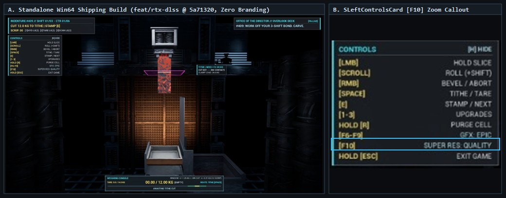
>
> *Caption: Standalone Win64 `Shipping` build on `feat/rtx-dlss` (`5a71320`, `445.62 MB`)—`[F10]` vendor-neutral `SLeftControlsCard` readout (`SUPER RES: QUALITY`) driving UE 5.8 NVIDIA DLSS 4.5 Super Resolution & DLAA with zero in-game vendor branding.*

---

## 8. Transparent AI Tool & SDK Inventory (Glass Box Declaration)

* **Google Gemini:** End-to-end Lead C++ Systems Architect, 3D geometry/physics derivations, code review, rule auditing, and release engineering.
* **Antigravity:** Local C++ and headless Python execution agent operating strictly under `DOCS/AGENT_RULES.md` Pre-Code Approval Gates.
* **Anthropic Console (`Claude API` — `$0.33` single-screenshot query):** Cold-eye visual hierarchy critique on a single mid-development screenshot, informing Phase 12D rear grate suppression and vertical pipe framing.
* **Hyper3D Rodin Gen-2.5:** `11` custom industrial `.glb` meshes and `27` embedded 2K PBR station textures integrated via headless `GeometryScript` automation.
* **fal.ai (`ElevenLabs Sound Effects v3` & `Mirelo SFX 2.0`):** `6` commercial-licensed `48 kHz` 16-bit industrial foley `.wav` files (`< $1.00` spend), combined with UE 5.8 MetaSounds and Python-synthesized PA intercom audio.
* **NVIDIA DLSS 4.5 UE 5.8 Plugin (`v8.9.0`, NGX SDK `310.9.16` — `feat/rtx-dlss` only):** Transformer-based Super Resolution (`DLSS-SR`) and Native AA (`DLAA`) driven via `UUpscalerSettingsSubsystem` (`[F10]`), with automatic `TSR` fallback on non-RTX hardware.
* **Evaluated & Explicitly Bypassed Tools (Not Used in Final Build):** `PBRgen` (`0` textures — bypassed in favor of procedural UE5 materials), `StreamlineDLSSG` / `DLSS-RR` (rejected to prevent Slate reticle ghosting and archive bloat), `WeLoveIndies` free pack (rejected due to Non-Commercial license), and `OpenAI` (not used).
